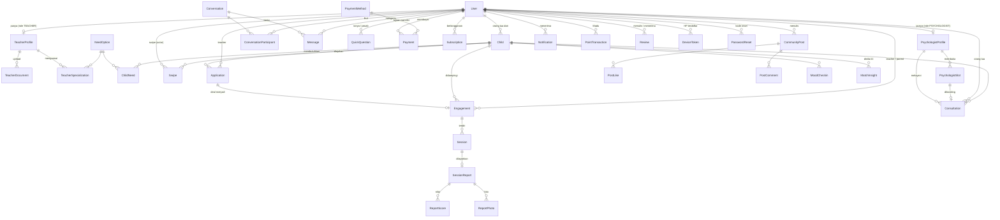

# Rancangan Database DUBIDU

- **DBMS:** PostgreSQL 15+ (produksi: Neon / Supabase, gratis)
- **ORM & migrasi:** Prisma 7 — sumber kebenaran ada di [`prisma/schema.prisma`](../prisma/schema.prisma)
- **Migrasi SQL:** [`prisma/migrations/`](../prisma/migrations) (dibuat otomatis, jangan diedit manual)
- **Data awal:** [`prisma/seed.ts`](../prisma/seed.ts)

## 1. Peta modul

| Modul | Tabel | Dipakai di layar |
|---|---|---|
| Akun & profil | `User`, `TeacherProfile`, `TeacherDocument`, `PsychologistProfile` | Login, Register, Profil |
| Child Needs Assessment | `Child`, `NeedOption`, `ChildNeed` | Register (child-data, child-needs), chip anak di Beranda |
| Smart-Matching | `TeacherSpecialization`, `Swipe`, `Application` | Swipe card, "Pengajuan Aktif", Riwayat |
| Pendampingan | `Engagement`, `Session` | "Teacher saat ini", Jadwal, Detail kontrak |
| Report Card | `SessionReport`, `ReportScore`, `ReportPhoto` | Report card (kalender & detail) |
| Komunikasi | `Conversation`, `ConversationParticipant`, `Message`, `QuickQuestion` | Chat, "Respon cepat" |
| Konsultasi psikolog | `PsychologistSlot`, `Consultation` | Konsultasi, pilih jadwal |
| Pembayaran | `Payment`, `PaymentMethod`, `Subscription` | Bayar (QRIS/rekening + bukti transfer), Dubidu Plus, Pendapatan teacher, verifikasi admin |
| Komunitas | `CommunityPost`, `PostLike`, `PostComment` | Tab Komunitas |
| Engagement harian | `MoodCheckin`, `PointTransaction` (Madu), `Notification`, `DoobieMessage` | Check-in, Notifikasi, Doobie |
| Ulasan | `Review` | Rating teacher & psikolog |
| Push notification | `DeviceToken` | Notifikasi di HP |
| Lupa password | `PasswordReset` | Kode OTP via email |
| AI matching | `MatchInsight` | Skor & alasan AI di kartu swipe |

## 2. ERD (diagram relasi)

> GitHub otomatis menggambar diagram di bawah ini.



## 3. Alur data utama

```
Registrasi orang tua ─► User(PARENT) + Child + ChildNeed
Registrasi teacher   ─► User(TEACHER) + TeacherProfile(UNVERIFIED)
   └─ upload dokumen ─► TeacherDocument, status PENDING ─► admin ─► VERIFIED

Swipe kanan (LIKE)   ─► Swipe + Application(PENDING)
Pihak lain menerima  ─► Application(ACCEPTED) + Conversation (chat terbuka)
Deal                 ─► Engagement(ACTIVE) ─► Session (jadwal) ─► Payment
Setelah sesi         ─► SessionReport + ReportScore + ReportPhoto ─► Notification ke orang tua

Konsultasi           ─► PsychologistSlot(isBooked) + Consultation(PENDING_PAYMENT) + Payment
Bayar                ─► Consultation(CONFIRMED) + Conversation(PSYCHOLOGIST)
Psikolog kirim hasil ─► Consultation(COMPLETED: observation, recommendation, followUp)

Check-in mood        ─► MoodCheckin + PointTransaction + User.points (Madu)
```

## 4. Aturan penting yang dijaga database

| Aturan | Cara |
|---|---|
| Email & no. HP unik | `@unique` di `User.email`, `User.phone` |
| Satu pengajuan per (anak, teacher) | `@@unique([childId, teacherUserId])` di `Application` |
| Satu report per sesi | `sessionId @unique` di `SessionReport` |
| Satu check-in per anak per user per hari | `@@unique([childId, userId, date])` |
| Slot psikolog tidak bisa dobel booking | `slotId @unique` + update bersyarat `isBooked=false` dalam transaksi |
| Satu like per user per post | primary key `[postId, userId]` |
| Hapus user → data turunannya ikut terhapus | `onDelete: Cascade` |
| Akun demo tidak bercampur dengan user sungguhan | `User.isDemo` — filter di semua daftar & pencarian; migrasi `demo_accounts` menandai akun seed yang sudah ada |
| Password tidak pernah disimpan polos | `passwordHash` (bcrypt) |

## 5. Smart-matching + AI matching (skor 0–100)

Dihitung di [`src/lib/matching.ts`](../src/lib/matching.ts):

| Faktor | Bobot | Sumber data |
|---|---|---|
| Irisan kebutuhan anak & spesialisasi teacher | 60 | `ChildNeed` ∩ `TeacherSpecialization` |
| Jarak (radius) | 20 | `User.latitude/longitude`, `TeacherProfile.radiusKm` |
| Rating & jumlah ulasan | 10 | `TeacherProfile.rating/reviewCount` |
| Terverifikasi | 10 | `TeacherProfile.verificationStatus` |

**Lapisan AI** ([`src/lib/aiMatching.ts`](../src/lib/aiMatching.ts)): 15 kandidat teratas dari skor aturan dinilai AI berdasarkan profil lengkap (kebutuhan anak, keterangan orang tua, kondisi rumah, report card terakhir ↔ pendidikan, pengalaman, pendekatan, spesialisasi teacher). AI memberi skor 0–100, 2–3 alasan, dan catatan. Skor akhir = 40% aturan + 60% AI. Hasil disimpan di `MatchInsight` dan hanya dihitung ulang bila profil berubah (`inputHash`). Nama & kontak tidak dikirim ke AI.

## 6. Pembayaran

**Mode manual (dipakai sekarang):** `PENDING` (user dapat `amountDue` = nominal + kode unik 1–999) → user upload bukti → `VERIFYING` → admin cek mutasi → `PAID` (atau ditolak → kembali `PENDING`). Tujuan transfer ada di tabel `PaymentMethod` (QRIS / rekening bank), bukti di `Payment.proofUrl`, admin pemeriksa di `verifiedById`. Pesanan `PENDING` yang lewat batas waktu → `EXPIRED`; yang `VERIFYING` tidak pernah dibatalkan otomatis.

**Mode Midtrans (opsional, nanti):** `Payment.invoiceNo` = `order_id` Midtrans. Alur status: `PENDING` → (webhook `settlement`/`capture`+`accept`) → `PAID`; `deny`/`cancel`/`failure` → `FAILED`; `expire` atau lewat 1 jam → `EXPIRED` (slot psikolog dilepas). Notifikasi terakhir disimpan di `gatewayPayload` untuk audit.

## 7. Cara mengubah struktur database

1. Edit `prisma/schema.prisma` (misal tambah kolom `Child.bloodType String?`).
2. `npm run db:migrate -- --name tambah_golongan_darah` → file SQL baru dibuat di `prisma/migrations/` dan langsung diterapkan ke database lokal.
3. Commit file schema **dan** folder migrasi baru.
4. Di server produksi, `npx prisma migrate deploy` (sudah otomatis di build command Render) menerapkan migrasi tersebut.

> Jangan pernah menjalankan `prisma migrate reset` / `db:reset` ke database produksi — semua data akan hilang.
